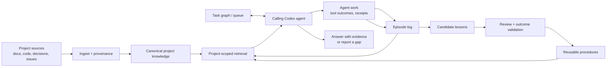
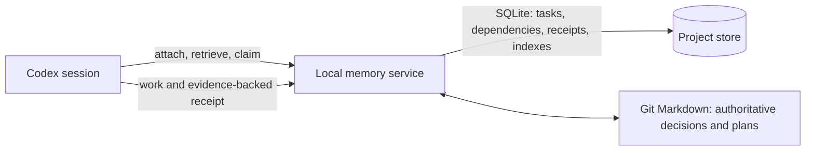

# Agent Memory System: GitHub Research and Planning

**Research date:** 2026-10-13  
**Phase:** Planning snapshot. The initial implementation began on 2026-10-13; see [README.md](README.md) and [ARCHITECTURE.md](ARCHITECTURE.md) for the implemented module and its current limits.

**Boundary update (2026-10-14):** AgentMem serves the Codex agent that calls it. It returns project knowledge, evidence, task state, and accepted lessons; it does not choose whether to delegate, create worker prompts, or direct another agent. Task goals, authorized paths, acceptance criteria, checkpoints, and receipts are declarative project data. Codex orchestration remains governed by Codex instructions and runtime. This decision supersedes the exploratory delegation-specific recommendations below; references to other products' agent coordination remain comparisons only.

## Recommendation

Build a project-scoped project-manager agent around an explicit, traceable project record and a reliable retrieval/workflow layer. Treat “full knowledge” as broad source coverage plus the ability to retrieve relevant evidence, explain gaps, and flag stale information. Do not try to keep every project file in the prompt or assume extracted summaries are always right.

The strongest design inspiration is **OpenViking’s inspectable context filesystem** for organizing project knowledge, memory, and skills; **Hindsight’s separation of experiences, evidence-backed observations, and reflective answers** for learning from work; and **Beads’ durable dependency-aware task graph** for long-running work. These solve different pieces. A first version should keep canonical project information in Markdown under Git, store searchable evidence and task/event metadata in a small database, and use a pluggable retrieval interface. Add a graph database only if relationship and temporal queries prove difficult.

The target is now Codex-first. Keep the knowledge model runtime-independent, but make the first client a Codex integration: project instructions plus a fast attachment/context tool, with a startup hook as an optional convenience. A Codex project-manager session is still the current Codex model operating under project instructions with retrieved project context; this design does not change model weights, create an infallible identity, or load every project fact into context.

## What I found

I searched GitHub repositories and inspected current default-branch READMEs, selected documentation/code search results, repository licenses, archive flags, and recent commit metadata. All candidates below reported unarchived when checked. Their feature descriptions are repository claims; benchmark results and production claims were not independently reproduced. This is a snapshot, not a ranking by popularity.

| Project | What the public implementation says it does | Fit for this goal | Main gap and caveat |
|---|---|---|---|
| [OpenViking](https://github.com/volcengine/OpenViking) | A context database that exposes knowledge, memories, and skills through a browsable `viking://` filesystem. It describes scoped search, directory summaries, and session commits that archive sessions and extract inspectable Markdown memories. The repo has agent-specific “experience memory” skills. | Closest match to one navigable, inspectable project context space that can include procedural experience. | AGPL-3.0; fast-moving API and model/provider setup. Its README reports benchmark gains, including task success from experience memory, but those are project-reported results, not validation for this use case. Recent commit observed 2026-10-13. |
| [Hindsight](https://github.com/vectorize-io/hindsight) | Explicit `retain`, `recall`, and `reflect` operations; separates world facts, agent experiences, evidence-backed observations, and mental models/knowledge pages. Its coding-agent integration describes a per-repository memory bank seeded from Git history and sessions, plus curated architecture/convention/current-work pages. The README explicitly gives an AI project manager as a reflect use case. | Strongest direct precedent for applying past project experience and reasoning across it. | MIT. It is a memory service with model/database costs and optional hosted Cloud; its benchmark claims are not proof of project-manager quality. Recent commit observed 2026-10-12. |
| [Cognee](https://github.com/topoteretes/cognee) | Turns documents, code, conversations, tickets, and agent work into searchable graph memory; the README describes persistent memory across runs, lessons/fixes, custom ontologies, MCP integrations, self-hosting, and a managed option. | Broad knowledge ingestion plus relationship-aware retrieval; useful if many source types and relations matter. | Apache-2.0. Graph construction and extraction introduce operational and correctness complexity; its “Company Brain” and quality statements are project descriptions. Latest commit metadata observed 2026-10-08. |
| [Graphiti](https://github.com/getzep/graphiti) | An Apache-2.0 framework for temporal context graphs. Facts have validity windows, derived facts point to source episodes, and retrieval combines semantic, keyword, and graph paths. | Good model for changing project facts, “what was true when?” questions, and traceable evidence. | It is a graph framework, not a complete project-memory/orchestration product; bring and operate a graph database. Its README distinguishes this OSS framework from Zep’s proprietary managed Context Graph Engine. Recent commit observed 2026-10-13. |
| [Mem0](https://github.com/mem0ai/mem0) | Apache-2.0 memory library/server with user, session, and agent scopes; current README describes semantic/BM25/entity retrieval and temporal reasoning. | A small reusable memory service if the system needs cross-agent or cross-session fact recall. | General-purpose personalization memory, not a project source-of-truth or task manager. README says some managed-platform benchmark optimizations are proprietary and OSS results may differ. Recent commit observed 2026-10-12. |
| [Letta Code](https://github.com/letta-ai/letta-code) | Apache-2.0 agent harness with memory, self-editing skills/prompts, Git-tracked MemFS, message search, and built-in subagents. The maintained code is now in this repository; the older [Letta server repo](https://github.com/letta-ai/letta) points users here. | A concrete integrated agent runtime to evaluate if the product should be a coding/project agent with long-lived identity and delegation. | Broader agent harness with cloud/local choices, not a neutral memory component. README notes automatic reflection is disabled by default on native Windows. Recent commit observed 2026-10-13. |
| [ACE](https://github.com/ace-agent/ace) | Apache-2.0 research implementation for evolving a structured playbook through generator, reflector, and curator roles; it uses feedback, incremental deltas, helpful/harmful counts, deduplication, and pruning. | Useful pattern for converting repeated work outcomes into reusable strategies without rewriting a whole memory blob. | Evaluated around benchmark tasks and playbooks, not authoritative project facts, provenance, task ownership, or project Q&A. Latest commit observed 2026-08-24. |
| [Beads](https://github.com/gastownhall/beads) | MIT, Dolt-backed issue/dependency graph for coding agents. Provides ready-work detection, task claiming, audit trails, memory commands, formulas/molecules/gates, and multi-agent coordination. | A useful comparison for dependency-aware task state and long-horizon work. | It records work and dependencies; it does not build a grounded project knowledge base or validate lessons. Dolt adds a storage/sync dependency. Recent commit observed 2026-10-13. |
| [LangGraph](https://github.com/langchain-ai/langgraph) | MIT low-level framework for stateful workflows, durable execution, checkpoints, and human interruption; points to [Deep Agents](https://docs.langchain.com/oss/python/deepagents/overview) for planning, subagents, and filesystem use. | A runtime choice if explicit workflow control and resumable delegation are priorities. | Orchestration is not knowledge curation: project memory, source provenance, lesson validation, and answer quality remain application work. Recent commit observed 2026-10-12. |

### Practical design lessons

1. **Keep evidence separate from interpretation.** Store source files and task/session records with project ID, path/URL, commit or source version, timestamps, and content hash. An extracted fact or lesson should point back to its evidence. Make the agent label answers as current, historical, inferred, or unverified.
2. **Use several kinds of memory.** Keep (a) canonical project facts and decisions, (b) episodes of work and outcomes, (c) validated lessons/procedures, and (d) active task state distinct. Hindsight’s experience/observation/mental-model split and ACE’s separate reflection/curation roles illustrate why “one vector store” is not a sufficient model.
3. **Make project scope explicit.** Every query, memory, lesson, task, and context response has a project identifier. Shared lessons need an explicit wider scope and evidence that they generalize. Do not let one project’s convention silently become another project’s rule.
4. **Retrieve by authority and time, not semantic similarity alone.** Combine exact keyword search, semantic search, and structured filters; include source authority, commit/version, effective date, and supersession. A recent README statement should not silently erase a recorded decision with different scope; surface both and ask or mark unresolved.
5. **Promote experience cautiously.** A successful or failed run is evidence, not automatically a universal rule. Candidate lessons should carry trigger/scope, procedure, expected result, evidence links, outcomes, confidence, and review date. Keep failures that reveal useful edge cases. Validate repeated lessons against later work; mark them superseded or disputed rather than silently rewriting history.
6. **Keep task state agent-neutral.** The project store records goals, evidence/constraints, authorized paths, acceptance criteria, checkpoints, and receipts. The calling agent decides how to use this data under its own instructions and runtime; the service does not assign work to another agent or compose a worker prompt. Track dependencies and claims atomically when multiple sessions share the project.
7. **Keep the graph optional at first.** A Markdown/Git source of truth plus SQLite tables/FTS and an embedding index can answer many initial needs. Use explicit typed links and timestamps so a graph can be added when real questions require multi-hop/temporal traversal. This is a design recommendation, not a feature claim from one repository.

## Recommended architecture

For an MVP, use human-readable Markdown files in a project-controlled directory for decisions, architecture, requirements, current status, risks, and procedures; preserve source documents/code in place. Maintain append-only work records and task state in SQLite or an existing tracker. Index content with full-text search first and add embeddings only after a retrieval evaluation shows a need. A small retrieval API should return snippets with source path, revision, timestamp, and confidence so a Codex tool, MCP server, CLI, or web app can share the same memory.

Do not generate an enormous project summary and call it “full knowledge.” Use short project entry points that point to detailed notes, and assemble a task-specific context packet on demand. Include freshness and missing-source information in the packet.

## Product form: shared local engine with MCP and CLI adapters

The practical default is a **local project-memory engine exposed through MCP, with a CLI as a direct fallback and a dashboard added only when inspection/editing needs justify it**. Treat the knowledge store as project-scoped and durable; treat MCP, the CLI, any dashboard, and an eventual agent runtime as separate ways to use it.

| Form | Strength | Limitation | Recommendation |
|---|---|---|---|
| CLI-first/local app | Explicit, scriptable, easy to test and inspect; `ask` can provide a human-friendly answer while `context --json` can retrieve evidence without another LLM call. | A standalone CLI does not automatically enter an agent's reasoning loop; a dedicated desktop app duplicates interface work before the memory model is proven. | Keep CLI commands as adapters and reliable fallback, not the only interface. |
| MCP/tool service plus CLI/dashboard | Exposes the same project-scoped retrieval and write operations to compatible agents and direct callers. Codex currently supports local stdio and remote Streamable HTTP MCP servers, and shares MCP configuration across its desktop, CLI, and IDE clients. [Codex MCP docs](https://developers.openai.com/codex/mcp) | MCP standardizes tool discovery and invocation, not a complete project manager. The protocol says tools may be model-controlled but does not mandate an interaction pattern; it does not guarantee the client will choose a tool, or orchestrate/validate delegated work. [MCP tools specification](https://modelcontextprotocol.io/specification/2026-07-28/server/tools) | Best shared interface for an initial agent-integrated system; keep mutations explicit and auditable. |
| Repository-local Markdown/knowledge files | Human-readable, versioned with the project, easy to review and retain as durable source of truth. OpenViking demonstrates an adjacent pattern with a browsable context filesystem and optional CLI, MCP, and hooks. [OpenViking](https://github.com/volcengine/OpenViking) | Files alone do not provide reliable search, citations, freshness checking, model answers, or task orchestration. Putting all state in a repository can also create noisy diffs and merge conflicts. | Keep canonical decisions and curated project notes here; index and query them through the shared engine. |
| Standalone chat/agent runtime | Can provide the clearest PM conversation and own planning, delegation, resume, and worker receipts in one experience. | Requires choosing/building model-provider handling, session state, worker runtime, permission policy, UI, and observability; too many product decisions before validating knowledge retrieval. | Defer until the project manager behavior and deployment boundary are clearer. |
| Automatic hooks/context injection | Can supply relevant lessons or project context at session start or before selected actions. OpenViking documents agent integrations using hooks plus MCP. [OpenViking integrations](https://github.com/volcengine/OpenViking#use-it-with-your-agent) | Runtime-specific and easy to make invisible, noisy, stale, or inconsistently triggered. It depends on host lifecycle support and cannot substitute for an explicit retrieval path. | Add as an optional adapter only after evidence shows which events benefit; log what was injected and allow inspection/disablement. |

Keep a single retrieval contract underneath every form. For example, 
`agentmem context --project sunflower --query "current API constraints" --json`
returns evidence records with source, revision, and freshness but calls no answer model; Codex can reason over those records in its own turn. 
`agentmem ask --project sunflower "Why was the API split?"` is a convenience wrapper that retrieves evidence and asks a configured model to answer with citations. The MCP server should expose equivalent explicit search/context and memory/task operations. Avoid making MCP's presence mean that the agent has already read or applied relevant lessons: the runtime must call the tools, and workflow guidance/evaluation must confirm use.

This preserves project isolation while avoiding separate, diverging implementations: project-specific Markdown and indexed evidence remain scoped by project ID; the local engine owns provenance, lessons, and retrieval; each runtime adapter chooses when to call it; and orchestration remains the responsibility of the calling runtime. The service returns relevant validated lessons and records evidence-backed receipts; it does not direct another agent or require a particular execution pattern. A lightweight dashboard can come later to browse source records, resolve stale/conflicting notes, and review lesson candidates without becoming a second source of truth.

## Codex-first attachment and fast path

**Supported Codex mechanisms.** OpenAI documentation describes `AGENTS.md` as project instructions Codex discovers at startup along the project-root-to-working-directory path. MCP servers can be configured for Codex, and current docs describe shared MCP configuration across the desktop app, CLI, and IDE. Codex reads an MCP server's `instructions` field as guidance alongside tool metadata; the model uses tool names/descriptions/schemas to decide whether and how to call tools. Skills can be selected when a task matches their description, so a skill is useful for the memory workflow but should not be the only attachment guarantee. Local Codex hooks document `SessionStart` events for `startup`, `resume`, `clear`, and `compact`; a command hook can return bounded `additionalContext`. These mechanisms provide instructions, tools, and startup context. They do not create a special project-manager role, guarantee every MCP tool will be called, or make a project group in the UI an authoritative project identifier.

**Proposed one-operation attachment.** Provide a proposed 
`attach_project(project_id)` operation, with a path-based resolver only where the runtime actually passes a trusted working directory. Codex hooks receive a session `cwd`; MCP calls should receive an explicit project ID unless the server process was deliberately launched with a project-specific working directory. Do not assume an MCP server can inspect the desktop's selected project or current conversation metadata. An explicit project binding or user selection resolves ambiguous workspaces and non-repository projects.

One attach call should return a small, versioned context response: project identity and scope; concise project purpose/requirements/architecture; current decisions and known risks; an active task checkpoint with last verified state, next action, constraints, and acceptance criteria; a handful of high-confidence fact/decision cards with source revision and links; applicable validated lessons; and the project index/source revision. Keep the response small enough for fast startup. It is an orientation layer with answer-ready evidence for common questions, not a claim of complete knowledge. If the current question is not covered or evidence conflicts, call narrow `retrieve_context(project_id, query, time_scope)` and return the best source excerpts. This retrieval call should return structured evidence without invoking a second LLM; Codex itself forms the answer. A CLI `ask` can remain a convenience path that retrieves then calls a configured model, while `context --json` exposes the same evidence-only operation.

**Fast resume.** On a new session or resume, attach the project brief and task checkpoint, then inspect only relevant changes since the checkpoint's recorded commit/revision and refresh affected cards. If no material change invalidates the next step, proceed from it without re-reading the whole knowledge base. If the workspace maps to multiple project IDs, the checkpoint has no trustworthy revision, or new evidence changes acceptance/architecture, ask for clarification or escalate. After useful work, the Codex agent explicitly records a receipt and changed evidence; hooks may help prompt or automate that update, but durable completion must be visible in the task/receipt record.

**Optional startup hook.** A trusted local `SessionStart` hook can map the event's `cwd` to a project and inject the concise brief, which may remove the separate attach round trip. MCP server readiness can lag session startup and hooks require supported local configuration/trust; retain the explicit attach MCP tool as fallback. Start with explicit tool calls until latency, project resolution, and packet correctness are measured. Keep automatic injection disableable and report the project identity it resolved. Avoid expanding the brief on every session: update it incrementally from source/work receipts and tie it to a revision.

**Calling-agent boundary.** Put concise instructions in project `AGENTS.md` (attach before substantive Q&A/work; cite retrieved evidence; check the active checkpoint; write a receipt and candidate lesson after work) and define a focused memory skill for deeper retrieval/curation. These are instructions, not an enforced persona or a way for tool output to outrank system/developer/user instructions. MCP descriptions and context outputs should supply evidence and project state to the calling agent, not prescribe model roles, dispatch, or instructions for another agent. Project ID, authorized paths, relevant lessons, task status, and receipt requirements remain data for the caller to use according to its own runtime policy.

### Backend and a useful todo list

Use **one local service with SQLite for mutable work coordination and derived indexes**, while curated project decisions, requirements, architecture, and procedures remain reviewable Markdown in Git. This gives tasks and receipts transactional state without making an opaque database the authority for project intent. SQLite’s transaction model and serialized writes fit a single-user local MVP; its one-writer behavior is a reason to route Codex sessions through one service and revisit PostgreSQL if multi-machine or high-concurrency use appears. [SQLite isolation](https://www.sqlite.org/isolation.html), [SQLite transactions](https://www.sqlite.org/lang_transaction.html). Keep generated briefs, fact cards, and search indexes derived and tagged with the source revision/hash; refresh affected records when evidence changes rather than maintaining duplicate canonical summaries.

The conceptual records can stay small: **projects** (stable ID and workspace mapping), **sources** (path, authority, hash/revision), **knowledge cards** (brief facts/decisions with citations and freshness), **tasks**, **dependencies**, **work receipts/episodes**, **lessons** (candidate/validated/superseded), and derived **brief/index metadata**. Active task state and receipts belong to SQLite; project knowledge remains in curated files. A source citation always resolves to the original file or artifact.

Make the todo view understandable at a glance: show a few next tasks, why they matter, priority, owner, acceptance criteria, and the next action; open a task to see its sources, dependencies, checkpoint, and history. “Ready” should be computed from dependencies rather than separately stored alongside a potentially contradictory blocked status. A simple task state is open, in progress, done, or cancelled; explain blocking reasons from unresolved dependencies or an explicit blocker field. Beads is a useful precedent: its documented `ready` view filters unblocked work, `--claim` atomically assigns/starts a task, and its task details retain an audit trail. Its Dolt-backed workflow could be adopted later if multi-agent synchronization becomes important; it need not dictate the first backend. [Beads workflow and concepts](https://github.com/gastownhall/beads/blob/main/docs/index.md).

Proposed service operations (design names, not existing Codex features) are `list_work(project_id)`, `claim_task(project_id, task_id)`, `get_task_context(project_id, task_id)`, and `record_receipt(project_id, task_id, receipt)`. A task records goal, dependencies, priority, authorized paths, acceptance criteria, source revision, owner/lease, and a restart checkpoint. Claim and state transition happen in one database transaction with a version check or idempotency key, so two sessions do not both start the same ready task. If an owner disappears, an expired lease can make the task claimable again; it does not mark work done. For an individual local project this is enough. If concurrent multi-machine writes become a requirement, evaluate PostgreSQL or a task system such as Beads rather than building sync prematurely.

For “keep working,” the active Codex session attaches to the project, loads the checkpoint and a short list of ready work, claims the relevant item, and checks only for source changes that could invalidate the checkpoint. It retrieves applicable validated lessons before acting. The calling agent proceeds according to Codex instructions and runtime policy. Afterward, it records changed artifacts, checks, remaining work, and evidence; mark the task done only when its acceptance criteria have evidence. Failed or interrupted work remains resumable, and the receipt can produce a candidate lesson for later review. The memory service returns project state and records work; it does not execute tasks or wake Codex. Unattended operation would need a separate supported scheduler/runtime and explicit authorization.

**Speed evaluation (targets to set, not measured results).** For a fixed pilot project, compare cold-session attach latency and token count, warm-session attach latency, common-question accuracy with source precision, escalation rate for uncovered questions, deeper retrieval latency, stale-brief detection after a changed source, and resume success without broad re-ingestion. Separate end-to-end time into tool startup/call, model latency, and context tokens/reading. Candidate targets: one attach call; common project questions answered from the brief in the same model turn; narrow follow-up retrieval only on evidence gaps; and a measurable reduction in repeated orientation tokens versus asking Codex to reread project notes. Set numeric thresholds only after a baseline run.

### Experience lifecycle

`task → evidence → outcome → candidate lesson → scope/review → validated lesson → retrieval/application → feedback`

The agent records what it tried and what happened, with links to commits, tests, artifacts, or user decisions. A reviewer proposes a reusable lesson with a specific trigger and scope. It remains a candidate until an owner or defined validation rule accepts it. When retrieved later, the agent can report whether it applied and whether it helped. Negative evidence reduces confidence or creates a dispute; new evidence can supersede a lesson while preserving its history. Never promote a generated explanation as a fact without checking its source.

## Phased plan and acceptance

**Phase 0 — Define the Codex boundary.** Choose one pilot project with accessible source material. Define how the Codex session maps to a project ID (explicit binding versus verified working-directory mapping), which source classes are in scope, canonical source precedence, and which paths the active agent may write. Start with explicit attachment unless a startup hook is shown to resolve the right project reliably.

**Phase 1 — Grounded project Q&A and attachment.** Build the source manifest, Markdown entry points, version metadata, compact manager brief, and retrieval with citations. Acceptance: attach in one operation to the correct project; answer common questions about intent, requirements, architecture, current status, and decisions directly from the packet; each factual claim links to the correct source/revision; report a gap when unsupported; detect a deliberately stale card after its source changes.

**Phase 2 — Continuity and work ledger.** Add task records, episodes, outcomes, status, links to artifacts/commits, restart checkpoints, and a compact todo view of ready, active, and blocked work. Acceptance: after a fresh agent session, resume an interrupted task from its checkpoint, check for relevant source changes, and identify completed/remaining work without inventing progress; distinguish historical state from current state.

**Phase 3 — Task coordination.** Add task dependencies, atomic claims, checkpoints, and evidence-backed receipt schemas. Keep task state declarative and available to the calling agent; do not add model-role or worker-dispatch policy to the memory service. Evaluate Beads as a component if cross-machine task synchronization is needed; otherwise start with local SQLite and one service writer. Acceptance: list unblocked work, prevent two sessions from claiming the same task, create a task from a user request, resume from a checkpoint, validate completion against criteria, and update task status only from evidence.

**Phase 4 — Experience learning.** Add lesson candidates and validation, then retrieval/application tracking. ACE offers a useful curation pattern; Hindsight/OpenViking offer closer memory workflows. Acceptance: construct one repeated failure and one successful procedure, show that the relevant lesson is retrieved on a later matching task, show that an irrelevant project lesson is excluded, and revise confidence when a later outcome contradicts it.

At every phase, measure answer correctness, source precision/recall, stale-fact detection, continuation success, lesson application, retrieval latency, and prompt tokens. Keep a small fixed test set with expected evidence links; benchmark scores from repositories are not substitutes for it.

## Decisions to make before implementation

- Should the first Codex session attach through an explicit `attach_project` tool call, or through a trusted local `SessionStart` hook with the tool call as fallback?
- What is the stable project-identity rule: explicit project ID, working-directory mapping, or both? How should non-repository projects bind?
- What token/latency budget should the always-loaded manager brief meet, and which high-frequency questions deserve precomputed fact cards?
- Is the initial project source set only a local Git repository and Markdown/docs, or must it include hosted issues/chat/drive sources?
- Should durable canonical knowledge remain plain files in Git, with SQLite as a rebuildable index, or should a shared Dolt/graph database become authoritative?
- Should SQLite also be authoritative for the active task queue and receipts while Git Markdown remains authoritative for curated project knowledge? This split is the recommended MVP boundary; a multi-machine collaboration requirement would change the database choice.
- Should “keep working” mean that the current Codex session continues when the user requests it, or is unattended scheduled execution also required? The latter needs a separate job runtime and authorization model.
- What lesson promotion rule is acceptable: human approval, repeated successful outcomes, or both?
- Does AGPL-3.0 OpenViking fit the intended distribution and dependency policy? If not, use it only as a design reference.

## Source links

- OpenViking: [repository and README](https://github.com/volcengine/OpenViking), [experience-memory skill](https://github.com/volcengine/OpenViking/tree/main/agent-plugins/skills/ov-experience-memory), [context layers](https://docs.openviking.ai/en/concepts/03-context-layers)
- Hindsight: [repository and README](https://github.com/vectorize-io/hindsight), [retain](https://hindsight.vectorize.io/developer/retain), [recall](https://hindsight.vectorize.io/developer/retrieval), [reflect](https://hindsight.vectorize.io/developer/reflect), [coding-agent integration](https://hindsight.vectorize.io/sdks/integrations/coding-agents)
- Cognee: [repository and README](https://github.com/topoteretes/cognee), [ontology guide](https://docs.cognee.ai/guides/ontology-support)
- Graphiti: [repository and README](https://github.com/getzep/graphiti), [Zep vs Graphiti distinction](https://github.com/getzep/graphiti#zep-vs-graphiti)
- Mem0: [repository and README](https://github.com/mem0ai/mem0), [open-source versus hosted benchmark note](https://github.com/mem0ai/mem0#new-memory-algorithm-april-2026)
- Letta Code: [current agent harness](https://github.com/letta-ai/letta-code), [memory docs](https://docs.letta.com/letta-code/memory), [subagents docs](https://docs.letta.com/letta-code/subagents)
- ACE: [repository and README](https://github.com/ace-agent/ace), [paper](https://arxiv.org/abs/2510.04618)
- Beads: [repository and README](https://github.com/gastownhall/beads), [concepts and architecture](https://github.com/gastownhall/beads/blob/main/docs/index.md)
- LangGraph: [repository and README](https://github.com/langchain-ai/langgraph), [memory documentation](https://docs.langchain.com/oss/python/langgraph/memory), [Deep Agents](https://docs.langchain.com/oss/python/deepagents/overview)
- Codex integration: [AGENTS.md instructions](https://learn.chatgpt.com/docs/agent-configuration/agents-md), [MCP configuration and tools](https://developers.openai.com/codex/mcp), [building MCP servers and tool guidance](https://developers.openai.com/plugins/build/mcp-server), [Codex hooks and SessionStart context](https://learn.chatgpt.com/docs/hooks), [skills](https://learn.chatgpt.com/docs/build-skills), and [subagents](https://learn.chatgpt.com/docs/agent-configuration/subagents)
